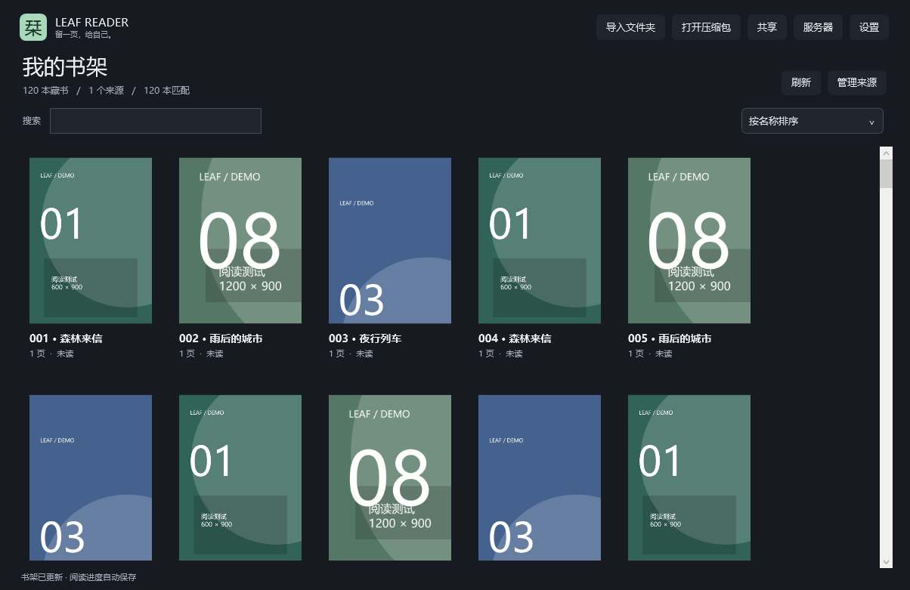

# Leaf Reader · 栞

**A lightweight comic and image reader for Windows and Android.**

Turn your existing image folders into a bookshelf and read on your computer or phone. A Windows computer can also share selected folders with a phone or another computer, loading pages on demand without downloading the whole book first.

[Download](https://github.com/ricefriend/leaf-reader/releases/tag/v2.3.2-preview) · [简体中文](README.md) · [Report an issue](https://github.com/ricefriend/leaf-reader/issues) · [Support development](https://ko-fi.com/gdbkf)

Current version: **2.3.2 public preview**. Free to use under the [MIT license](LICENSE). No account or cloud service required.

## New in 2.3.2

Improved Windows preloading for large photos, source folders in both bookshelves, and Android remote-folder loading and cancellation. The bottom status shows the loading stage and elapsed time; tap failures to retry. Update both apps for the full fix. See [release validation](VALIDATION-2.3.2.md).

## What can you do with it?

- **Browse a local collection:** import a parent folder, scan subfolders recursively, and use each book's first naturally sorted image as its cover.
- **Choose your reading direction:** single page, left-to-right spreads, right-to-left spreads, or continuous vertical Webtoon reading.
- **Handle spread alignment:** shift the starting page on Windows; temporarily join the previous or next page on Android, then return to your reading position.
- **Read comfortably on a phone:** inertial vertical scrolling, horizontal swipe animations, pinch zoom, and dragging while zoomed in.
- **Read images stored on a computer:** enable read-only sharing on Windows, pair by QR code or address, and stream pages to Android or another Windows computer.
- **Pick up where you left off:** save reading position, mode, and bookmarks automatically. Android also offers password-encrypted backup and restore.

## Preview



This screenshot shows the actual Windows application with program-generated example images.

## Features

### Bookshelf and local files

Choose a flat library or group books by imported parent folder / authorized remote directory. Open a source cover to browse its books; the view preference is saved.

- **Use your existing folders:** each subfolder directly containing images becomes a book. No repackaging is required.
- **Uniform covers, continuous scrolling:** no shelf pagination. Columns adapt to the available width; Android has a draggable fast-scroll rail for navigating large shelves.
- **Natural sorting:** `2.jpg` comes before `10.jpg`. Chinese characters, spaces, and special characters in filenames are supported.
- **Search and sort:** search by book name or folder, and sort by name, reading history, or time. Windows also offers unread-first sorting.
- **Folders and archives:** read image folders and ZIP / CBZ files. Android uses the system folder picker, without requesting all-files access.

Time sorting uses the metadata available from the source: Windows local folders and archives use filesystem creation time; Android local folders use modification time reported by the document provider.

### Four reading modes

| Mode | How it works |
| --- | --- |
| Single page | One image at a time for ordinary image viewing or page-by-page reading. |
| Left-to-right spreads | Two pages side by side, arranged and navigated from left to right. |
| Right-to-left spreads | Two pages side by side, arranged and navigated from right to left. |
| Continuous vertical / Webtoon | Images stacked vertically for comics and long images. This is the default for new books on Android. |

Zoom, pan, jump to a page, add bookmarks, and resume your saved position. Reading controls can hide when idle, and the progress bar follows the reading direction. Preferences are available in Settings.

### Handling spreads

**Windows: shift the spread's starting page.**

If a spread belongs to pages **12–13**, but the cover has left you viewing **11–12**, shift the starting page forward by one. You will see **12–13**, followed by **14–15** on the next turn. Use the toolbar, `[` / `]`, or `Shift + ←` / `Shift + →`.

You can also keep the cover on its own and display wide images alone, so an image already containing a full spread is not forced into a pair.

**Android: temporarily join adjacent pages.**

From any reading mode, join the current page with the previous or next page to inspect a spread. End the join, or press the system Back button, to return to your original reading position.

### Share from Windows, read on a phone or computer

- Windows can read locally, host a sharing service, or connect to another Windows instance as a client.
- Sharing is **off by default**. Choose the folders to expose; local reading continues after sharing stops.
- Android can scan the pairing QR code. Android and Windows clients can also pair by entering the service address and code.
- Save multiple servers, reconnect, remove profiles, and browse authorized folders.
- Load thumbnails for covers and suitable previews while reading; request higher-resolution content when zooming. There is no requirement to copy the whole remote folder first.
- Prefetch nearby pages, cancel outdated requests, and use bounded caches with a cleanup action. Android reads visible regions of very long images when the format supports region decoding.
- Sharing is read-only, with no remote upload, delete, or file-edit endpoints.

### Settings and saved state

- Chinese / English interface.
- Default mode for new books, spread rules, automatic control hiding, and cache management.
- Android options for keeping the screen awake while reading and managing local folder permissions.
- Reading positions and bookmarks saved independently on each client.
- Encrypted Android backups include server authorizations, bookmarks, progress, and preferences, but no images. Local folders need fresh permission after migration.

## Download and install

Get the files from [v2.3.2-preview](https://github.com/ricefriend/leaf-reader/releases/tag/v2.3.2-preview):

| Platform | Download | Requirements |
| --- | --- | --- |
| Windows | `LeafReader-2.3.2-preview.exe` | Windows 10 / 11, .NET Framework 4.8+. Run directly; no installer needed. |
| Android | `LeafReader-Android-2.3.2-preview.apk` | Android 8.0+. Use this APK for a new installation. |

The release also contains full source code and a `SHA256SUMS.txt` file.

Official 2.3 / 2.3.1 preview APKs can be updated in place without losing data or pairing again. The old-certificate migration APK remains on the [first release page](https://github.com/ricefriend/leaf-reader/releases/tag/v2.3.0-preview).

**Previously installed a development test APK?** First install `LeafReader-Android-2.3-migration-debug.apk` over the old app, export and verify an encrypted backup, then uninstall and install the preview APK. Do not uninstall before verifying the backup. See [migration instructions](MIGRATION.md). New users do not need the migration APK.

## Getting started

### Read local images

1. Choose **Import folder** on Windows, or **Local** on Android and grant access through the system folder picker.
2. Select the parent folder containing your books and wait for the scan.
3. Open a book and choose a reading mode. New Android books default to vertical scrolling; you can change the default in Settings.

For example, importing `Comics` creates separate books for `Book A` and `Book B`:

```text
Comics/
├── Book A/
│   ├── 001.jpg
│   ├── 002.jpg
│   └── 003.jpg
└── Book B/
    ├── 01.png
    └── 02.png
```

### Read images shared by a computer

1. Connect the phone and computer, or both computers, to the same local network.
2. On the Windows computer storing the images, open **Sharing**, choose folders, and start the service.
3. Scan the QR code from **Servers** on Android, or enter the address and pairing code on Android or another Windows computer.
4. Browse the shelf and open a book. The sharing computer must keep the application running and stay awake.

HTTP is intended for trusted LANs or private VPNs. Cross-network connections should use protected HTTPS or a VPN. Leaf Reader does not automatically map public ports.

## Controls

### Windows

| Action | Control |
| --- | --- |
| Turn pages | Mouse wheel, arrow keys, `PageUp` / `PageDown`, or click the sides of the image. Left/right arrows follow the reading direction. |
| Next / previous page | `Space` / `Shift + Space`. |
| Shift a spread | `[` / `]` or `Shift + ←` / `Shift + →`. |
| Zoom and pan | `Ctrl + mouse wheel`, `+` / `-`; drag the image, or press `0` to reset. |
| First / last page or jump | `Home` / `End`; `Ctrl + G` to jump. |
| Fullscreen / back | `F11` or double-click; `Esc` exits fullscreen, then returns to the shelf. |
| Bookmark / mode | `B` toggles a bookmark; `1` / `2` / `3` / `4` select the four reading modes. |
| Shelf and help | `Ctrl + O` to import, `Ctrl + F` to search, `F5` to rescan, `F1` for help. |
| Reveal hidden controls | Move to the upper/lower edge or press `Tab`. |

### Android

- Swipe vertically to scroll. A fast swipe continues with inertia; touch the view to stop it.
- Swipe horizontally in left/right modes to turn pages with an animation.
- Pinch to zoom and drag with one finger while zoomed. These gestures are handled separately from ordinary page turns.
- Use the reading controls for mode selection, bookmarks, and temporary page joins. Tap the center to show or hide controls; tap the sides to turn pages in the chosen reading direction.
- System Back exits a temporary join first, then returns from the reader to the shelf.

## Supported files and current limits

- Windows supports JPG / JPEG, PNG, BMP, GIF, and TIFF. GIF / TIFF display the first frame; WebP depends on the system decoder.
- Android uses system decoders for common image formats. Some local formats, such as TIFF, may not decode; the Windows service can generate compatible previews for remote reading.
- ZIP / CBZ are supported; PDF and RAR / CBR are not. Android caches a local archive for entry access, with a current limit of 200 MiB per archive.
- The desktop app currently supports Windows. Android provides local reading and a remote client, without hosting a sharing service.
- Progress is not synchronized across devices. Automatic server discovery and compatibility with Komga, OPDS, or SMB are not implemented.
- Version 2.3.2 is a public preview. See [current validation](VALIDATION-2.3.2.md) and [earlier device coverage](VALIDATION-2.3.md). The new Android UI behavior still needs device acceptance testing.

## Development, feedback, and support

Windows uses WPF / C# and Android uses native Java. They communicate through the Leaf Share v1 protocol.

- [Build and test](BUILDING.md) · [Android build](android/README.md)
- [Architecture](ARCHITECTURE.md) · [Sharing protocol](protocol/leaf-share-v1.md)
- [Issues](https://github.com/ricefriend/leaf-reader/issues) · [Contributing](CONTRIBUTING.md)
- [Security](SECURITY.md) · [Privacy](PRIVACY.md)
- [MIT license](LICENSE) · [Third-party notices](THIRD-PARTY-NOTICES.md)

Issues and contributions are welcome. Maintenance is on a best-effort basis, without guaranteed response or merge times. Remove personal paths, comics, pairing codes, and access tokens before posting public reports.

If Leaf Reader is useful to you, you can support development through [Ko-fi](https://ko-fi.com/gdbkf). All reading features remain free.
