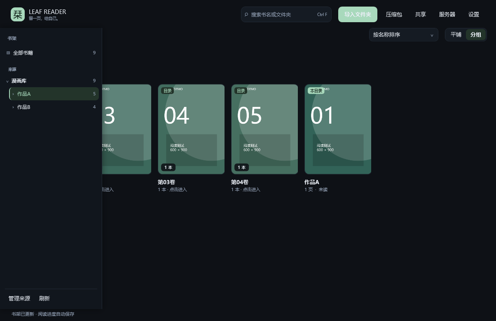
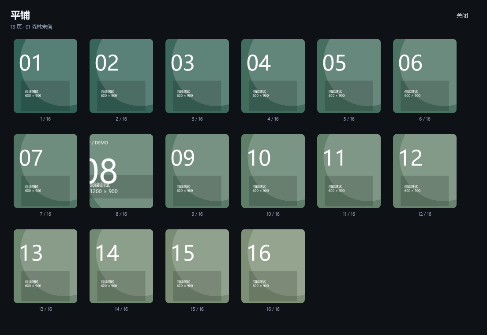
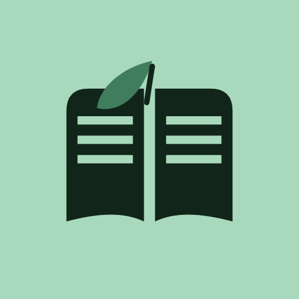

# Leaf Reader

A reader for the manga folders you already have. It runs on Windows and Android, and when the desktop is sharing a folder, your phone can read from it directly instead of downloading a whole book first.

Current version: **2.4.3**.

## How it works

On Windows, choose “Import folder” and pick the parent folder. On Android, choose “Local” and grant access through the system folder picker.

The scanner walks down through the folder. Every folder that directly contains images becomes a book, with the naturally first image as its cover. ZIP / CBZ files can be read directly as well.

The shelf can show everything flat, or group books by source. Grouping goes down through subfolders, but it does not add levels just for the sake of it:

- a folder that still has subfolders becomes a folder card;
- the last folder that directly holds images is the book itself, without an extra “folder → book” step;
- if a folder has its own images and subfolders, its own images appear as a “This folder” book next to the child folders.

## Reading

Both platforms support single page, left-to-right spreads, right-to-left spreads, and continuous vertical Webtoon reading. Page turning, zoom, panning, jumping to a page, bookmarks, and resume-where-you-left-off work the same way as before.

On Windows, spread mode can shift its starting page with `[` / `]`, and the cover or a wide double-page image can be shown alone. On Android, you can temporarily join the previous or next page while reading, then return to where you were.

Windows book cards have a `▦` button in the corner: click the cover to read, or click `▦` to see every image in that folder as a thumbnail grid and start from a specific page. Android does not use a tiny corner button; long-press the card and choose “Start reading” or “View all as grid” from the bottom sheet.

## Reading from a computer

The Windows app can share selected image folders, read-only. Turn sharing on, then pair from Android by QR code or address; another Windows computer can connect as a client too.

Sharing is off by default and only exposes the folders you choose. Stopping sharing only stops remote reads; the local shelf keeps working. Images are loaded on demand, not copied to the phone first. For connections outside your home network, use HTTPS or a VPN; the app does not create public port mappings.

## What changed in 2.4.0

The Windows shelf was rebuilt. Wide windows get a folder-tree sidebar that stays out of the way until the pointer reaches the left edge; narrow windows use breadcrumbs instead. Colours, typography, cards, and folder cards were redrawn for both the dark and light themes.

The folder tree is the main feature. After importing a parent folder, grouping by source can continue through subfolders. Leaf folders are books, so a two-level library stays two levels. The flat shelf, search, sorting, reading progress, and bookmarks are all still there.

The reading controls now fade and move slightly when they hide, and fade back in when they return.

Android now has the folder tree, breadcrumbs, flattened leaf folders, the long-press action sheet, the thumbnail grid, and a new adaptive launcher icon.

Details and test notes are in [VALIDATION-2.4.md](VALIDATION-2.4.md), [VALIDATION-2.4.1.md](VALIDATION-2.4.1.md), [VALIDATION-2.4.2.md](VALIDATION-2.4.2.md) and [VALIDATION-2.4.3.md](VALIDATION-2.4.3.md).

## What changed in 2.4.3

- **Preserve scroll position on delete & auto-refresh**: Deleting a folder or receiving a background auto-refresh now anchors on the surviving card in view and keeps the current scroll offset (while preserving unchanged cover thumbnails), instead of jumping back to the top of the bookshelf.
- **Boundary catch & transition notice on folder penetration**: Turning past the end (or start) of a book pauses once with an on-canvas prompt (`Reached the end · turn again for next book: ...` with a 250ms anti-flick guard and quick action button); turning again switches books and shows a clear `Now reading next · ...` banner so you always notice the transition.

## What changed in 2.4.2

- **Right-click delete in bookshelf**: Right-click any local folder card, book folder card, archive, or sidebar folder node on Windows to open it in Explorer or confirm moving it to the Recycle Bin, immediately updating the bookshelf and watch roots.
- **Folder penetration reading**: Turning past the last page (or scrolling past the bottom in Webtoon mode) automatically continues directly into the next book or across nested subfolders without returning to the bookshelf; turning back before page 1 returns to the end of the previous book. Includes a toggle in the reader bar and Settings plus "Previous book" / "Next book" toolbar buttons.

## What changed in 2.4.1

- Added a visible Refresh button directly on the Windows bookshelf toolbar (available at all window widths), and allowed `F5` to trigger a refresh even while the search box is focused.
- Added debounced `FileSystemWatcher` monitoring on imported Windows folders so newly added, renamed, or removed folders update the bookshelf automatically without restarting; changes detected while reading are deferred until returning to the bookshelf.
- Replaced the old tree-only Windows folder dialog in both "Import folder" and "Add shared folder" with the native Explorer folder picker (`IFileOpenDialog` with `FOS_PICKFOLDERS`), supporting editable address bar navigation and search.
- Pre-populated Windows LAN sharing with valid folders already imported into the library by default, while letting you remove any default folder and remembering dismissed defaults across reopens.
- Android now quietly checks authorized local folders when returning to the bookshelf from the background and refreshes automatically if folders changed.

## Download

The Windows build is on the [Releases](https://github.com/ricefriend/leaf-reader/releases) page as `LeafReader-2.4.3-preview.exe`. It runs on Windows 10 / 11 with .NET Framework 4.8 or newer.

The Android package is `LeafReader-Android-2.4.3-preview.apk`, for Android 8.0 or newer.

## Not there yet

- PDF, RAR and CBR are not supported; image folders and ZIP / CBZ are.
- The desktop app is Windows-only. There is no macOS or Linux build.
- Android is a client only; it cannot act as a sharing server.
- Reading progress is not synced between devices.
- WebP support on Windows depends on the system decoder; GIF / TIFF show the first frame.
- Android has to cache a local archive before reading it; the current limit is 200 MiB per archive.

## Development and feedback

Windows is WPF / C#; Android is native Java. Both use the [Leaf Share v1 protocol](protocol/leaf-share-v1.md).

- [Build and test](BUILDING.md) · [Android build](android/README.md)
- [Architecture](ARCHITECTURE.md)
- [Issues](https://github.com/ricefriend/leaf-reader/issues) · [Contributing](CONTRIBUTING.md)
- [Security](SECURITY.md) · [Privacy](PRIVACY.md)
- [MIT licence](LICENSE)

If Leaf Reader is useful to you, you can support development through [Ko-fi](https://ko-fi.com/gdbkf). Reading features stay free.

