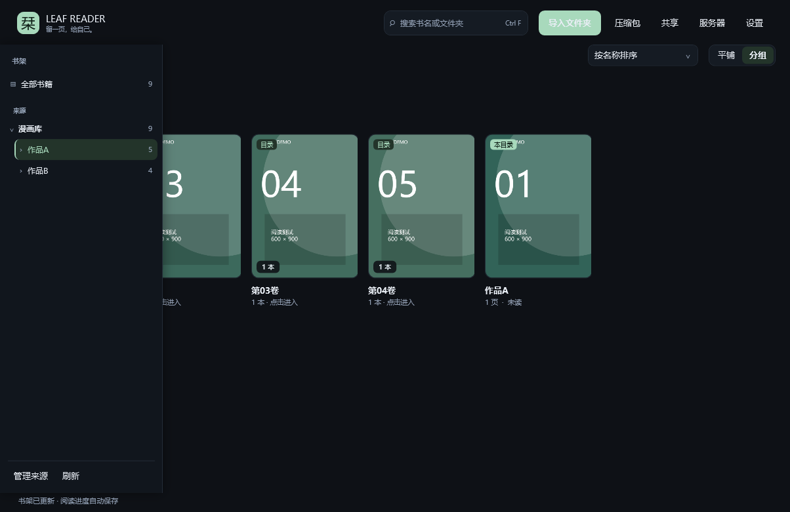
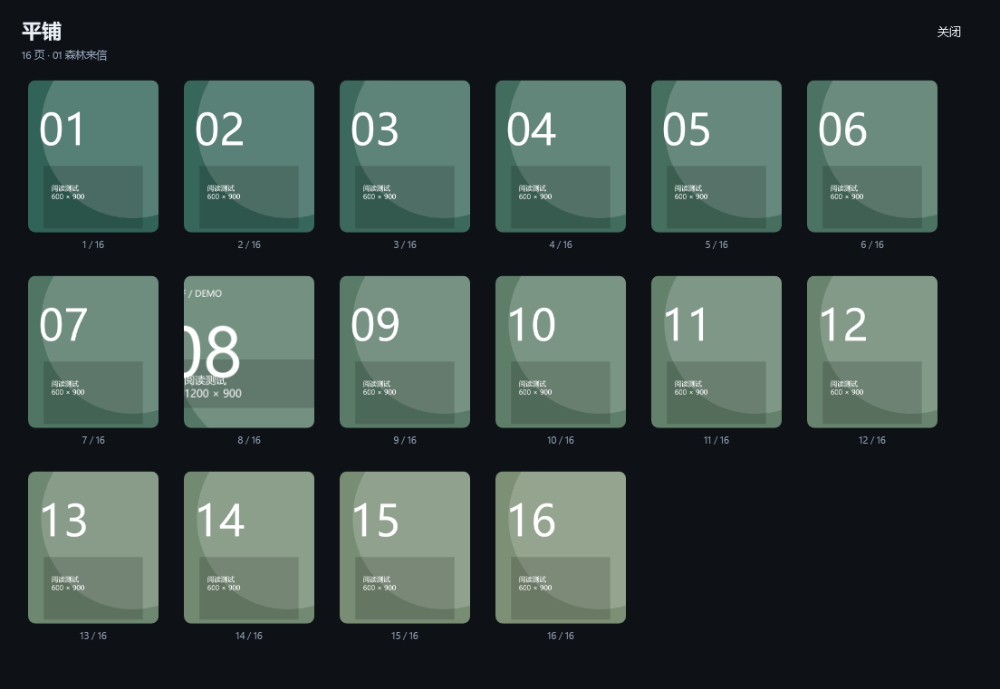

# 栞 · Leaf Reader

把现成的漫画文件夹当书架用。Windows 和 Android 都有客户端；电脑开着共享时，手机也能直接翻电脑上的图，不用先把整本拷过去。

当前版本 **2.4.0**。Windows 预览包已经构建；Android 源码也跟上了这一版，但 APK 还没在这台机器上编译。

## 怎么用

Windows 上点“导入文件夹”，选漫画的母文件夹。Android 上点“本地”，用系统的目录选择器授权文件夹。

扫描时会递归往下找：每个直接放着图片的文件夹是一本书，封面取文件名自然排序后的第一张。ZIP / CBZ 也能直接读。

书架可以平铺，也可以按来源分组。分组之后能沿着子目录一层层进去，但不会为了层级而层级：

- 还包含下级目录的文件夹，显示成目录卡；
- 直接放着图片的最后一层，就是书本身，不会再套一个“目录 → 书”的多余步骤；
- 一个文件夹既有自己的图、又有下级目录时，会把自己的图作为“本目录”书卡一起显示，不会丢。

## 看书

Windows 和 Android 都支持单页、从左到右双页、从右到左双页、Webtoon 纵向连续四种模式。翻页方向、缩放、拖动、跳页、书签这些不必重新学一遍；阅读位置会自动保存。

Windows 双页模式可以按 `[` / `]` 调整起始页，处理跨页图；也可以让封面或横图单独显示。Android 在阅读时可以把前一页或后一页临时拼过来，退出拼接后回到原来的位置。

Windows 书卡右上角有一个 `▦`：点封面直接进阅读，点 `▦` 则先把这本书所在文件夹里的所有图片铺成缩略图，点哪张就从哪页开始。Android 没有放这个小按钮，而是长按书卡，在底部操作表里选“开始阅读”或“平铺查看全部 N 张图”。卡片本身够大，长按比在封面上戳一个小图标稳。

## 在局域网里读电脑上的图

Windows 端可以只读共享指定的图片目录。开启共享后，安卓扫码或手动输入地址配对，另一台 Windows 电脑也能作为客户端连过来。

共享默认关闭，开哪些目录由你选；停止共享只影响远程读取，本地书架照常使用。图片按需加载，不会先把整个文件夹复制到手机。跨网络请用 HTTPS 或 VPN，程序不会自动做公网端口映射。

## 2.4.0 这次改了什么

Windows 书架整体重做了一版：宽屏用自动收起的目录树侧栏，鼠标移到左侧滑出，移开一会儿再收起；窄屏自动换成面包屑。配色、字体、卡片和目录卡都重画了，浅色和深色都能用。

目录树是这次的重点。导入母文件夹后，按来源分组可以继续往子目录里走；叶子目录直接作为书，不再多出一层。原有的平铺书架、搜索、排序、阅读进度和书签都没有拿掉。

阅读界面的自动隐藏改成了淡出加轻微位移，唤出时反向淡入，不再是瞬间出现/消失。

安卓端源码同步了目录树、面包屑、叶子目录还原、长按操作表、平铺网格和新的自适应启动图标。**这次没有构建 Android APK**，因为本机没有 JDK / Android SDK；已有的 2.3.2 APK 仍然是旧界面。

更细的测试记录在 [VALIDATION-2.4.md](VALIDATION-2.4.md)。

## 下载

Windows 包在 [Releases](https://github.com/ricefriend/leaf-reader/releases) 里，文件名是 `LeafReader-2.4.0-preview.exe`，Windows 10 / 11，.NET Framework 4.8 以上，双击就能运行。

Android 2.4.0 APK 还没构建；构建方法和依赖见 [BUILDING.md](BUILDING.md) 与 [android/README.md](android/README.md)。在 APK 出来之前，现有 2.3.2 APK 仍可继续使用。

## 目前还不支持

- PDF、RAR、CBR 暂时不能直接读；支持图片文件夹和 ZIP / CBZ。
- 桌面端只有 Windows，没有 macOS / Linux 版本。
- Android 只能作为客户端，不能反过来给别的设备当共享服务端。
- 阅读进度不会在设备之间同步；每台设备各记各的。
- Windows 的 WebP 支持取决于系统解码器；GIF / TIFF 只显示第一帧。
- 安卓本地压缩包需要先缓存单个包，目前上限 200 MiB。

## 开发与反馈

Windows 用 WPF / C#，Android 用原生 Java，两端共用 [Leaf Share v1 协议](protocol/leaf-share-v1.md)。

- [构建与测试](BUILDING.md) · [Android 构建](android/README.md)
- [架构说明](ARCHITECTURE.md)
- [问题反馈](https://github.com/ricefriend/leaf-reader/issues) · [参与贡献](CONTRIBUTING.md)
- [安全说明](SECURITY.md) · [数据与权限](PRIVACY.md)
- [MIT 许可证](LICENSE)

如果它帮到你，可以通过 [Ko-fi](https://ko-fi.com/gdbkf) 支持开发。阅读功能一直免费。

